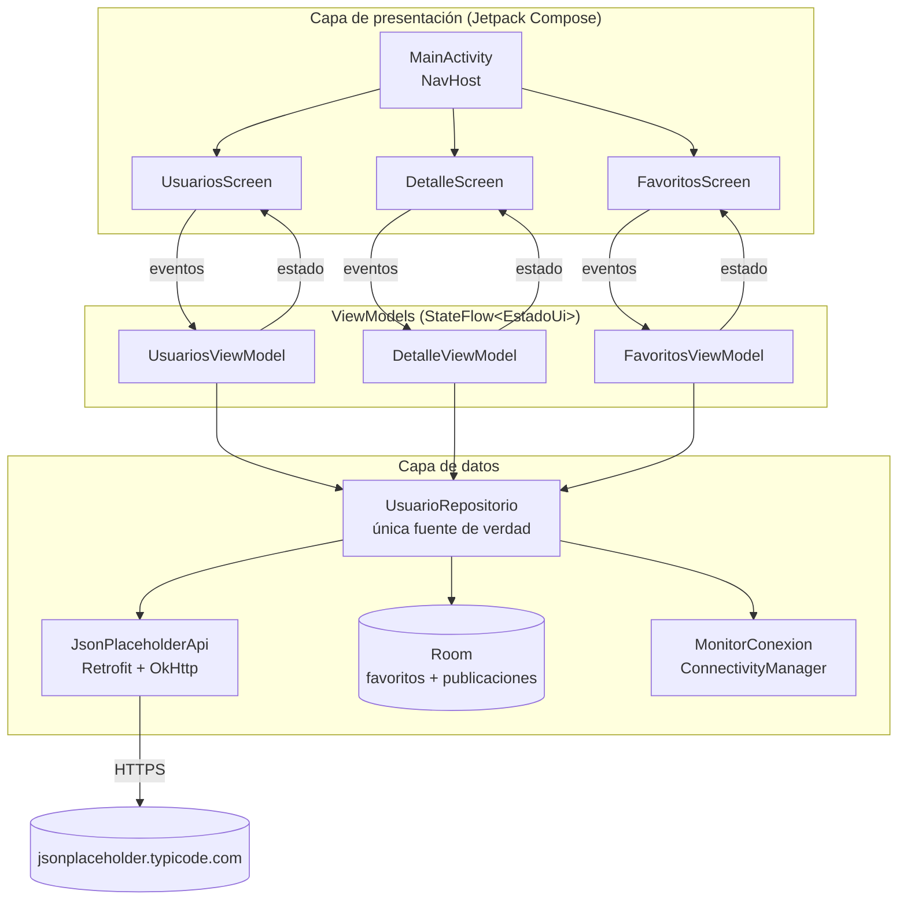
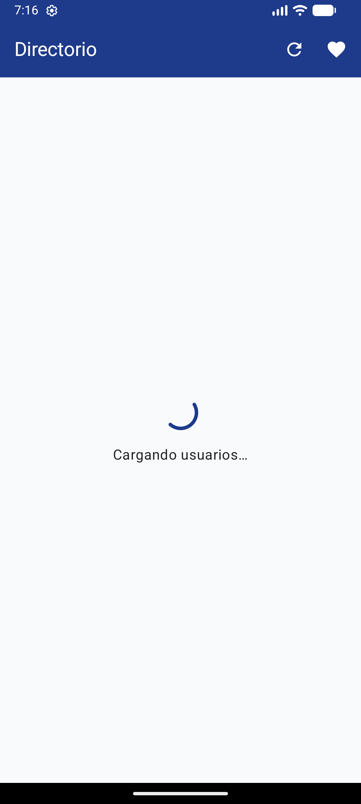
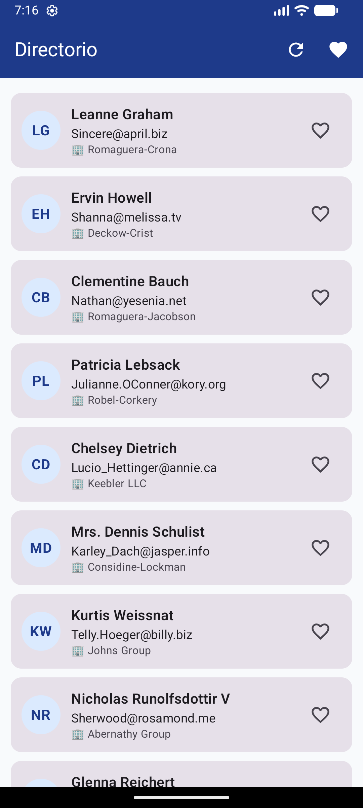
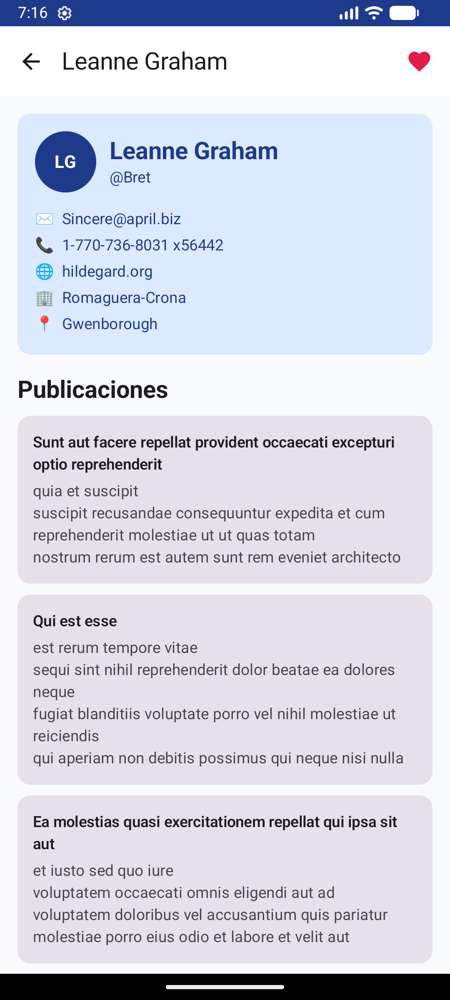
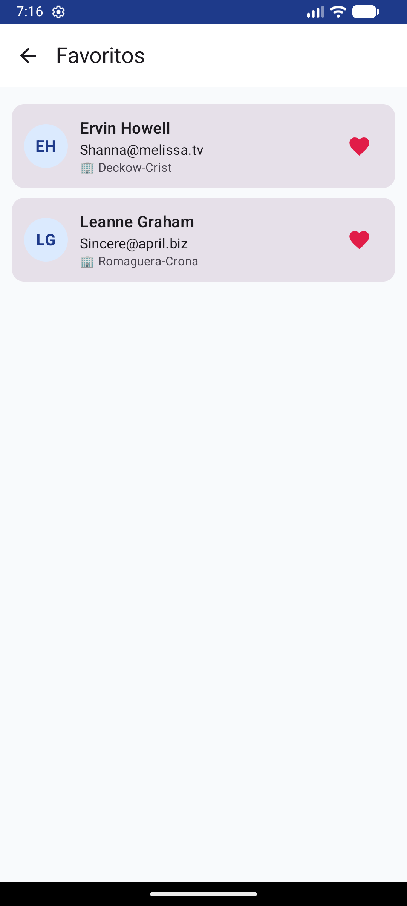
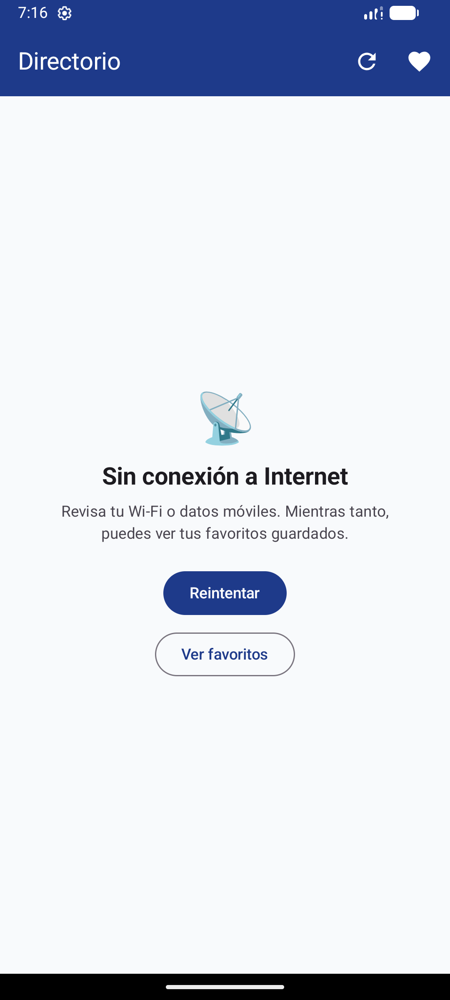
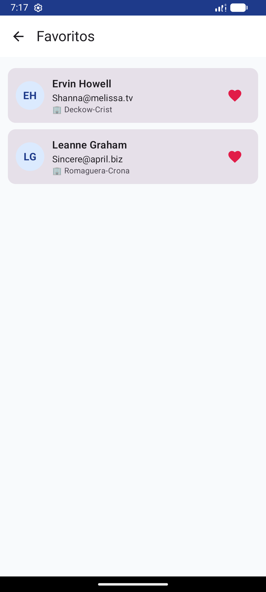
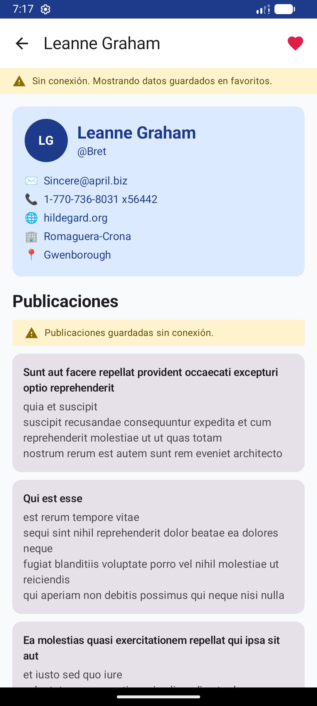

# Directorio — Tarea 5 (Programación de Dispositivos Móviles)

App Android de directorio que consume la API pública **JSONPlaceholder**.
Kotlin · Jetpack Compose · MVVM · Retrofit · Room · Navigation Compose.

| Requisito | Dónde |
|---|---|
| 1. Lista de usuarios (nombre, correo, `company.name`) | `ui/usuarios/` ← `GET /users` |
| 2. Detalle + publicaciones | `ui/detalle/` ← `GET /posts?userId={id}` |
| 3. Favoritos guardados localmente y visibles sin conexión | `data/local/BaseDatos.kt` (Room) + `ui/favoritos/` |
| 4. Estados: carga, error, sin Internet (la app no se cierra) | `ui/comun/EstadoUi.kt`, `ui/comun/Componentes.kt`, `UsuarioRepositorio.llamar()` |
| 5. Retrofit + permiso de Internet | `data/remoto/`, `AndroidManifest.xml` (`INTERNET`, `ACCESS_NETWORK_STATE`) |
| 6. Arquitectura + ciclo de vida | Esta página |

## Arquitectura: MVVM por capas



- **UI (Compose):** solo dibuja el estado y envía eventos (tocar, reintentar, marcar favorito). No conoce Retrofit ni Room.
- **ViewModel:** guarda el estado de cada pantalla en un `StateFlow<EstadoUi>` (`Cargando`, `Exito`, `Error`, `SinConexion`) y sobrevive a la rotación.
- **Repositorio:** decide si los datos vienen de la API o de Room, y convierte **toda excepción** en un `Resultado` (por eso la app nunca se cierra por un error de red).
- **Datos:** Retrofit (remoto), Room (local) y `MonitorConexion` (estado de la red).
- **Dependencias:** se crean una sola vez en `DirectorioApp` (inyección manual con un `Contenedor`).

### Estructura
```
app/src/main/java/com/cmoronta/directorio/
├── DirectorioApp.kt          # Application + contenedor de dependencias
├── MainActivity.kt           # única Activity, navegación
├── data/
│   ├── modelo/Modelos.kt     # Usuario, Publicacion, Resultado
│   ├── remoto/               # JsonPlaceholderApi (Retrofit), DTOs, ClienteRetrofit
│   ├── local/BaseDatos.kt    # Room: entidades, DAO, base de datos
│   ├── red/MonitorConexion.kt
│   └── repositorio/UsuarioRepositorio.kt
└── ui/
    ├── comun/                # EstadoUi + pantallas de carga / error / sin conexión
    ├── usuarios/  detalle/  favoritos/   # Screen + ViewModel de cada pantalla
    └── tema/
```

## Ciclo de vida y carga de datos

| Momento del ciclo de vida | Qué pasa con los datos |
|---|---|
| `Application.onCreate()` | Se crean Retrofit, Room y el repositorio **una sola vez** (`DirectorioApp`). |
| `Activity.onCreate()` → `setContent` | Se dibuja la navegación. Cada pantalla pide su ViewModel con `viewModel(factory = …)`. |
| Primera creación del ViewModel (`init {}`) | Se lanza la petición (`cargar()`) en `viewModelScope`. Estado: **Cargando**. |
| `onStart` … `onStop` | `collectAsStateWithLifecycle()` observa el `StateFlow` solo mientras la pantalla está visible; en `onStop` deja de observar (ahorra batería). |
| `onResume` | `LifecycleEventEffect(ON_RESUME)` en la lista: si la última carga falló (error o sin conexión), **reintenta** al volver a la app. |
| Rotación / cambio de configuración | La Activity se destruye y recrea, pero **el ViewModel sobrevive**: no se repite la descarga. |
| Muerte del proceso | El `id` del detalle se recupera de `SavedStateHandle` (argumento de navegación). |
| `ViewModel.onCleared()` (al salir de la pantalla) | `viewModelScope` se cancela y con él cualquier petición en curso. |

Además, si la app está en "sin conexión" y vuelve Internet, `MonitorConexion` lo detecta y la lista se recarga sola.

## Ejecutar

1. Abrir la carpeta en **Android Studio** y esperar la sincronización de Gradle.
2. Ejecutar en un emulador o teléfono (Android 7.0+ / API 24).

Desde la terminal (Windows):
```
gradlew.bat assembleDebug        :: genera app/build/outputs/apk/debug/app-debug.apk
gradlew.bat testDebugUnitTest    :: pruebas del repositorio
```

## Pruebas

`app/src/test/.../UsuarioRepositorioTest.kt` (5 pruebas):
lista correcta, sin Internet → `SinConexion`, error HTTP → mensaje claro, favorito y publicaciones visibles sin conexión, quitar favorito borra sus publicaciones.

## Capturas

| Cargando | Lista | Detalle | Favoritos | Sin conexión | Favoritos sin conexión | Detalle sin conexión |
|---|---|---|---|---|---|---|
|  |  |  |  |  |  |  |
